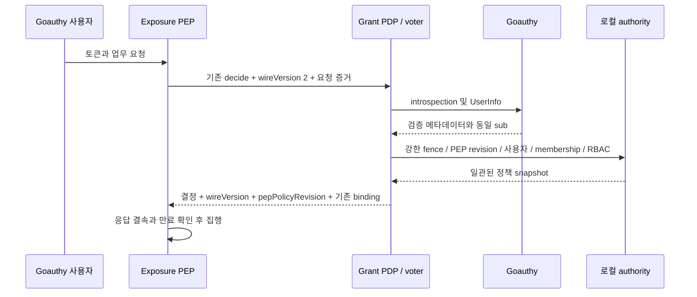

# Goauthy 사용자 독립 인가 설계

- 상태: **Grant v0.8.0 · Exposure v0.3.0 발행 완료 · 단계 1 fixture와 최종 CI 통과**
- 이번 갱신은 확인된 발행·CI 결과를 문서에 반영한다. 코드·빌드·런타임·배포 작업은 수행하지 않는다.
- 아래 MUST는 발행된 사용자 인가 계약이다. live IED, 실제 Goauthy 배포 버전·cloud 동작과 단계 2 remote learner는 여전히 미검증이다.

## 발행과 검증 근거

[Grant v0.8.0](https://github.com/mrchypark/grant/releases/tag/v0.8.0)은 PR #14의 merge `1e0eea5eb435b0798441dce9a9b1b0a668f4ea3b`다. 시험한 `8b3cc0fc959f4d6ed6c4e6e2b396107218751c09`와 파일 차이가 없으며 [최종 PR CI](https://github.com/mrchypark/grant/actions/runs/41950428624), [Exposure process interop을 포함한 전체 수동 CI](https://github.com/mrchypark/grant/actions/runs/41950457179), [이미지 발행](https://github.com/mrchypark/grant/actions/runs/41958102856)이 통과했다. 대응 릴리스는 Exposure v0.3.0이다. 단계 1은 실제 Grant PDP·native upstream과 Exposure 프로세스 및 통제된 issuer 응답을 사용한 fixture 근거이며 실제 운영 issuer나 IED 배포 시험은 아니다. 과거 v0.7.0 기준선과 설계 당시 구현 계획은 아래에 구분해 보존한다.

## 개요와 문제

v0.7.0의 `POST /api/v2/http-capabilities/decide`는 관리 application 문맥을 요구했다.
사용자 토큰과 로컬 RBAC가 유효해도 application admission 없이 독립적으로 판단할 수 없었다.
v0.8.0의 첫 단계는 기존 Goauthy 사용자 검증을 재사용하여 이 의존성만 분리한다.
서버 PEP 설정에서 `application` 또는 `user`를 선택하며 요청자는 모드를 선택하지 못한다.

## 설계 당시 v0.7.0 기준선과 근거

아래 목록의 ‘현재’는 설계 당시 출시 v0.7.0의 `bdc186f`를 가리키는 역사적 기준선이다. wireVersion·인가 모드·revision·private GET·CAS가 추가된 v0.8.0 상태를 설명하지 않는다.

- `internal/grant/service_models.go`의 입력·응답에는 `wireVersion`이 없다.
- `internal/grant/store_capability_types.go`의 PEP에는 인가 모드·정책 revision이 없다.
- 현재 PEP upsert 입력은 `lifecycle`, `validUntil`이며 application ID 입력은 지원하지 않는다.
- PEP PUT은 `/ops/providers/{providerId}/enforcers/{pepClientId}`이며 master 관리 경로다.
- 기존 GET은 `/api/v2/http-capabilities/catalog/{providerId}`와 관리용 active catalog GET이다.
- 확인한 라우트에는 PEP 단건 관리 GET이 없다. 존재한다고 가정하지 않는다.
- 현재 PUT의 CAS 지원도 확인되지 않았다. 아래 CAS는 같은 PUT을 확장하는 제안이다.
- `service_capabilities.go`는 PEP·catalog·요청 증거를 검사하고 application 문맥을 해석한다.
- 기존 결정은 `requestBinding`과 canonical digest를 반환하며 유효기간은 5초다.
- `auth_goauthy.go`는 introspection과 UserInfo를 호출하고 두 subject를 대조한다.
- 기존 검증은 client, audience, scope, 만료와 issuer 설정을 검사한다.
- 현재 Goauthy 반환 identity의 `ClientID`는 설정 application ID다. 실제 client와 구분해야 한다.
- `GRANT_GOAUTHY_APPLICATION_ID`는 현재 설정 검증에서 필수 문자열이다. 그 문자열 요구는 application 레코드 생성이나 IdP client 등록을 뜻하지 않는다.
- 런타임 키는 기존 전역 `GRANT_APP_AUTH_KEY`이며 `X-Grant-App-Auth-Key`로 검증한다. 설정된 `GRANT_HTTP_CAPABILITY_PEP_CLIENT_ID`와 provider registry가 PEP 범위를 결속한다. provider별 새 키를 발급하는 계약이 아니다.

## 목표와 비목표

- 관리 application 레코드가 0개여도 적법한 Goauthy 사용자의 RBAC 인가가 가능해야 한다.
- application 모드의 admission·동의·기존 계약은 유지해야 한다.
- user 모드는 활성 로컬 사용자, 조직 membership, RBAC를 MUST 요구한다.
- 자동 사용자 생성, 자동 membership·역할·grant 부여는 MUST 금지한다.
- 첫 범위는 Goauthy의 검증된 사용자 계정 resource owner 토큰 경로뿐이다. ‘human proof’는 이 계정 의미이며 사람이 현재 키보드 앞에 있다는 증명은 아니다.
- 첫 Exposure 연동은 기존 compact JWT 형태의 Goauthy 사용자 토큰을 사용한다. Exposure의 opaque 토큰 지원 확장은 범위 밖이다.
- 서비스 principal, 다른 IdP, JWT 자체 검증, 새 UI·decision 경로는 비목표다.
- 이전의 ‘새 엔드포인트 없음’은 수정한다. 기존 관리 경로에 GET 메서드 하나만 추가한다.
- 인증 서버나 provider 업무 API의 동작 변경도 비목표다.

## 핵심 사용자 여정

1. 사전 조건: 관리자가 기존 PEP PUT으로 user 모드를 명시적으로 설정한다.
   요청 시 유효한 사용자·조직 membership·RBAC와 일치하는 증거가 있으면 허용한다.
   application 레코드가 없어도 되지만 사용자 권한이 없으면 거부한다.
2. 사전 조건: 기존 PEP의 모드는 누락되었거나 null이다.
   기존 요청을 보내면 application 모드로 처리하며 admission을 생략하지 않는다.
3. 사전 조건: 앞선 요청은 허용되었으나 membership 또는 역할이 회수되었다.
   다음 요청은 최신 authority를 확인하여 거부하고 provider 업무 코드는 그대로 둔다.

## 구조와 신뢰 경계



PEP는 기존 전역 AppAuthKey 인증과 configured PEP ID/provider registry 검사, lifecycle·만료 검사를 MUST 유지한다.
새 provider 키 발급·키 저장소·client 등록은 추가하지 않는다.
토큰·증거만 보고 application에서 user로 자동 전환하는 동작은 MUST 금지한다.
런타임 PEP는 master 키를 MUST 보유하거나 전송하지 않는다.
관리 PUT의 master 권한과 런타임 catalog·decide 자격은 분리한다.
통신은 TLS 또는 접근이 제한된 private transport를 MUST 사용한다.

## 최소 필드와 마이그레이션

| 위치 | 계약 필드 | 의미 |
|---|---|---|
| PEP 저장·upsert | `authorizationMode` | `application` 또는 명시적인 `user` |
| PEP 저장·조회 | `policyRevision` | 서버가 관리하는 양의 int64 범위 revision |
| decide 입력·응답 | `wireVersion` | 누락은 legacy, user 계약은 정수 `2` |
| decide 입력·응답 | `pepPolicyRevision` | catalog에서 받은 예상값·서버 판단값 |
| catalog 응답 | `authorizationMode`, `pepPolicyRevision` | PEP가 계약을 확인하는 서버 정책 정보 |

catalog의 새 필드는 user 모드에서만 전송한다. application catalog는 모든 새 필드를 MUST 생략하여 기존 strict parser와 호환한다.
application의 legacy decision도 `wireVersion`, `pepPolicyRevision`을 비롯한 모든 새 필드를 MUST 생략한다. null·0·기본값을 출력하는 것은 생략이 아니다.
application 모드의 v2 요청은 새 decoder가 명시적으로 지원하는 경로에서만 허용하며, 이 경우에도 revision을 검사하고 v2 응답을 반환한다.
위 표는 필드 위치를 설명하며 모든 응답에 필드를 추가하라는 뜻이 아니다.

- 저장된 legacy 모드의 누락·null은 마이그레이션에서 MUST `application`으로 채운다.
- 신규 생성 시 모드 생략도 application이다. 기존 user 레코드의 PUT 생략은 현재 모드를 보존한다.
- 현대 PUT의 모드 null은 현재 모드와 관계없이 MUST 거부한다. user는 문자열로 명시한다.
- 알 수 없는 모드·버전·잘못된 타입은 MUST 거부한다.
- `policyRevision` 초기값은 1이며, 기존 레코드에도 같은 논리 기본값을 적용한다.
- 모드 변경은 revision 증가와 함께 같은 원자적 쓰기로 MUST 커밋한다.
- lifecycle·만료 등 집행에 영향을 주는 PEP 변경도 revision을 MUST 증가시킨다.
- 클라이언트가 revision을 임의 지정하거나 감소시키는 것은 MUST 금지한다.
- revision 범위는 `1..9223372036854775807`이며 상한에서 변경은 거부하고 overflow를 MUST 금지한다.
- 기존 migration SQL·checksum은 MUST 보존하고 다음 번호 migration만 추가한다.
- 설계 당시 migration 1..5 다음 번호 6과 NOT NULL·SQL CHECK 제약을 제안했다. 이는 당시 물리 저장 설계 기록이며 발행된 저장 구현을 이 제안만으로 추정하지 않는다. 실제 저장 형태와 호환성은 [스키마 문서](database-schema.md)를 따른다.
- 후속 migration은 적용 직전 다음 번호를 재확인하며 다른 작업의 migration을 덮어쓰지 않는다.
- legacy 행은 application·revision 1로 backfill하며 기존 관계·영수증은 보존한다.
- 변경 시 `docs/database-schema.md` 반영은 필수이며, 이 문서 작업에서는 수정하지 않는다.

## 기존 경로 재사용과 CAS

v0.8.0은 기존 PUT에 동일한 관리 권한 검사를 유지하면서 CAS를 추가했다.
같은 `/ops/providers/{providerId}/enforcers/{pepClientId}`에 GET 하나를 추가했다.
GET은 PUT과 같은 master 인증·private 노출 경계를 MUST 유지한다.
disabled·expired 상태와 활성 catalog 부재에도 저장된 PEP 상태와 `ETag` 헤더를 반환한다.
없는 PEP는 GET 404이며 생성 PUT은 `If-None-Match: *`를 MUST 요구한다.
catalog GET은 런타임 계약의 모드·revision만 제공하며 관리 CAS 조회에 의존시키지 않는다.
정책 ETag는 strong ETag이며 정확한 형식은 `"pep-policy-<h>"`다.
`h`는 기존 `sha256Text(providerId + "\n" + pepClientId + "\n" + decimal(policyRevision))`의 결과다.
즉 h는 `sha256:` 접두사와 64자리 소문자 hex를 포함한다. revision 십진수에는 선행 0이 없다.
두 ID는 기존 길이 제한을 유지하고 CR·LF를 MUST 거부하여 필드 구분의 모호성을 없앤다.
관리자는 응답 `ETag` 값을 그대로 PUT `If-Match`에 전달한다. 약한 ETag는 허용하지 않는다.
선행 조건이 없으면 MUST 428, 불일치·동시 갱신이면 MUST 412를 반환한다.
관리 GET은 상태를 읽기만 한다. 새 승인 서비스·경로·사용자 플래그는 만들지 않는다.
CAS·revision·PEP 변경은 한 트랜잭션이어야 하며 실패 시 부분 갱신은 MUST 없어야 한다.

**JSON 조각: 기존 PEP PUT 본문의 일부이며 전체 요청이 아니다.**

```json
{"authorizationMode":"user","lifecycle":"active","validUntil":null}
```

**JSON 조각: decide 입력의 추가 부분이며 전체 요청이 아니다.**

```json
{"wireVersion":2,"pepPolicyRevision":7}
```

**JSON 조각: decide 응답의 추가 부분이며 전체 응답이 아니다.**

```json
{"wireVersion":2,"pepPolicyRevision":7}
```

## 사용자 principal과 토큰 검증

- Exposure는 기존 compact JWT에서 요청 증거용 힌트를 추출할 수 있지만, 그 힌트는 인증 근거가 아니다. Exposure에 JWKS 조회나 JWT 서명 검증을 추가하지 않는다.
- Grant의 실제 introspection·UserInfo 결과가 subject·실제 client·audience 검증의 권위 있는 근거다. 요청 힌트는 그 결과와 대조하며 신뢰하거나 검증을 생략하지 않는다.
- Grant는 기존 Goauthy 설정의 신뢰 issuer와 검증된 `sub`를 로컬 사용자에 MUST 매핑한다.
- introspection은 active, 실제 `client_id`, `aud`, scope, 만료를 기존 설정과 MUST 대조한다.
- 요청에 새 client hint를 추가하지 않는다. 권위 있는 실제 client ID는 introspection에서만 얻는다.
- issuer는 신뢰하는 설정·검증 경로에 결속하며 응답에 있으면 정확히 일치해야 한다.
- user 모드의 audience 증거는 실제 검증된 토큰 audience와 MUST 일치해야 한다.
- 기존 `goauthyAudiences`의 `len(values) == 1 && values[0] == resource`를 MUST 유지한다.
- audience가 없거나 둘 이상이면 MUST 거부한다. 다중 audience 지원은 추가하지 않는다.
- application 모드의 기존 appId 기반 audience 의미는 그대로 유지한다.
- 현재 필수인 application ID 설정 문자열은 legacy projection을 위해 남을 수 있다. user 모드에서 이 문자열을 근거로 application 레코드·client binding·trust를 생성하거나 조회하지 않는다. IdP client 자동 등록도 하지 않는다.
- introspection의 sub 존재만으로 사용자 계정 resource owner라고 판단하는 것은 MUST 금지한다.
- introspection·UserInfo 성공과 동일 sub는 필수이며, 그 사용자 계정 의미는 아래 issuer 계약 근거에 의존한다. 실시간 사람의 현존은 보장하지 않는다.
- issuer 운영자가 제공한 계약이 지원 사용자 flow의 resource owner만 이 경로를 통과함을 보장해야 한다.
- user 활성화 전에 운영자 제공 사용자 positive·client-credentials negative 벡터를 MUST 검증한다.
- 계약 또는 벡터가 없으면 해당 배포는 user 모드 미지원이며 MUST fail closed한다.
- 이는 배포 수용 조건이며 새 승인 API·플래그·principal binding client ID를 추가하지 않는다.
- service token이 UserInfo 사용자 증명을 충족한다고 추정하지 않는다. 서비스 principal은 후속 설계다.
- **OWNER-VERIFIED v0.3.9 계약 선행 조건 확인:** Goauthy 소유자 세션 `01a0e3c9`는 [공식 발행 태그 v0.3.9](https://github.com/mrchypark/goauthy/tree/v0.3.9)의 소스와 기존 historical CI를 확인했다. `server.go:644–646`은 `client_credentials`의 `openid` 요청을 400으로 거부한다. `userinfo.go:33–95`는 유효한 access token·`openid`·저장된 session의 비어 있지 않은 `Subject`·활성 user를 요구한다. `machine.go:19–67`의 JWT `sub=clientID`는 저장된 `Subject`를 채우지 않으므로 `clientID=userID` 충돌도 사용자 증명을 만들지 않는다.
- 기존 사용자 GET·POST 200, machine·expired·revoked·non-openid 401, OIDC의 `openid` 누락·`client_credentials` 400 벡터는 소유자 확인 근거다. 정확한 시험명과 출처 한계는 [OWNER-VERIFIED 참조](principal-authz-references.md#goauthy-v039-사용자-발급-계약-owner-verified)에 기록한다. 이번 작업에서 Goauthy 소스나 시험을 직접 확인하지 않았고 새 cloud 실행도 없다. 실제 issuer 배포 버전과 해당 배포의 cloud PASS는 여전히 미검증이므로 배포 수용 조건은 유지한다.
- 활성 로컬 사용자와 조직 membership을 확인하고 기존 RBAC로 action·resource를 MUST 판단한다.
- user 모드만 application 조회·admission·동의를 생략한다. 토큰 client 검증은 생략하지 않는다.
- 조직 누락·불일치·비활성 상태를 자동 보정하거나 다른 조직으로 대체해서는 안 된다.

## 계약 결속·일관성·회수

- user PEP는 wireVersion 2를 MUST 요구하고 누락·legacy 요청을 application으로 되돌리지 않는다.
- application PEP의 누락 버전 요청은 기존 계약을 유지한다. 버전 2 사용은 모드를 변경하지 않는다.
- legacy application catalog·decision에는 모든 새 필드를 생략한다. application v2는 새 decoder의 명시적 지원이 있어야 하며 user v2와 동일하게 예상 revision을 MUST 검사한다.
- 요청의 모드 지정 필드는 MUST 거부하며 서버 PEP만 모드를 결정한다.
- 버전 2 입력의 `pepPolicyRevision`은 MUST 필수이며 PEP는 catalog revision을 그대로 보낸다.
- Grant는 같은 snapshot의 서버 revision과 입력을 MUST 대조하고 불일치하면 403으로 거부한다.
- 버전 2 응답은 입력 버전과 일치한 서버 정책 revision을 MUST 반환한다.
- PEP는 catalog에서 확인한 revision과 응답 revision, 모든 기존 binding을 MUST 대조한다.
- 불일치 시 전달을 중단한다. catalog 갱신 후 새 작업만 새 요청으로 인가할 수 있다.
- 후속 검사에서 원래 revision이 stale이면 MUST 거부한다. 실행한 write·upstream을 재생하지 않는다.
- 이미 실행한 작업을 새 revision으로 재인가하여 원래 검사를 대체하는 것도 MUST 금지한다.
- 기존 `requestBinding` nonce와 canonical digest·principal digest 체계를 재사용한다.
- user 응답의 기존 `principalDigest`는 정확히 `ExposurePrincipalDigest(userID, organizationID, "")`다.
- 세 번째 인수는 길이 0의 문자열이며 생략·null·client ID로 대체하는 것은 MUST 금지한다.
- 정확한 bytes는 `UTF8(domain) || BE64(len(UTF8(u))) || UTF8(u) || BE64(len(UTF8(org))) || UTF8(org) || BE64(0)`다.
- domain은 `grant.exposure-read.principal.v1`이며 전체 SHA-256을 접두사 없는 소문자 hex로 반환한다.
- 버전·서버 모드·revision은 기존 nonce·digest 대조와 함께 결정 결속의 MUST 조건이다.
- 새 hash 체계나 mode를 principal digest에 넣는 별도 공식을 만들지 않는다.
- mode·revision은 인증된 private catalog/decision envelope에서 결속한다. immutable catalog JSON의 hash, contract hash 및 기존 digest 공식에 새 필드를 섞지 않는다.
- `principalDigest` 공식과 내부 user ID의 소유자는 Grant다. Exposure는 Grant 내부 user ID를 알 수 없으므로 digest를 재계산한다고 가정하지 않는다.
- Exposure는 digest의 접두사 없는 64자리 소문자 hex 형식을 검사하고, 같은 작업의 initial decision과 follow-up decision에서 동일한지 대조한다. 이것만으로 최초 principal을 검증했다고 주장하지 않으며 credential·subject·audience·request 및 revision 결속 검사를 함께 유지한다.
- provider credential, method, path, query, header, body, resource 및 batch·response 증거를 MUST 보존한다.
- 활성 catalog generation·digest·contract hash와 다른 PEP 증거는 MUST 거부한다.
- 매 요청은 강한 read fence로 PEP 설정 revision과 authority 전체를 같은 snapshot에서 MUST 읽는다.
- voter도 이 요청 전체 일관성을 충족해야 한다. 기존 개별 strong read만으로 충족했다고 주장하지 않는다.
- `localReplicaRead`는 현재 voter를 우회하므로 그것을 호출하는 것만으로는 부족하다.
- 단계 1 voter는 직접 `s.db.Query`의 linearizable `SELECT 1`로 `AppliedSlot` fence를 얻는다.
- 이는 `serveReadFence`의 기존 강한 query 방식이며 Local에서 loopback fence 통신은 만들지 않는다.
- 그 fence로 기존 `readAtFence`를 호출하여 voter의 로컬 DB에도 read scope를 적용한다.
- `runtime.go`의 `QueryRaw`는 이미 scope에서 replica 또는 `s.db.Query`를 사용하고 slot을 검사한다.
- PEP·catalog·사용자 문맥·membership·RBAC의 모든 조회는 그 scope를 MUST 통과한다.
- 첫 조회 slot은 fence 이상이어야 하고 나머지 조회 slot은 첫 slot과 MUST 같아야 한다.
- 변경 시 부분 결정을 버리고 전체 로컬 판단을 재시도한다. `readAtFence`의 기존 최대 3회를 재사용한다.
- 총 3초 예산은 기존 learner 방식처럼 fence 획득부터 적용하도록 voter에도 제안한다.
- 외부 introspection·UserInfo는 이 로컬 예산 밖에서 한 번 수행하고 로컬 재시도에서 반복하지 않는다.
- 검증 결과는 요청 내부에서만 재사용한다. IdP와 DB 사이의 분산 snapshot을 주장하지 않는다.
- 단계 2 learner만 기존 원격 `readFence`·catch-up을 사용한다. 실패·예산 초과는 MUST 503이다.
- `runtimeDBQueryReplicaAtSlot` API는 존재하지 않으므로 도입하거나 전제하지 않는다.
- allow 결정 캐시는 MUST 사용하지 않는다. 이전 allow나 IdP 장애를 근거로 허용하지 않는다.
- batch·response 후속 판단도 같은 principal·모드·revision 조건을 MUST 유지한다.
- 빈 batch도 인증·조직·membership·PEP 검사를 먼저 수행하며 무조건 allow해서는 안 된다.
- 이미 발급한 결정의 기존 5초 유효기간은 유지한다. 진행 중 요청의 즉시 회수를 보장하지 않는다.
- 새 요청에서 회수를 관측하는 보장과 이미 집행 중인 작업의 취소 보장은 구별한다.

## 오류·운영·배포 단계

오류 본문은 안정적인 일반 코드·메시지만 MUST 제공하며 토큰·secret·내부 정책은 노출하지 않는다.
인증 무효는 401, 권한·증거 불일치는 403, 지원하지 않는 계약은 400을 사용한다.
PDP·IdP·fence 이용 불가는 503이며 CAS는 428/412를 사용한다.
단계 1은 Grant와 Exposure가 같은 pod에서 voter로 판단하며 learner를 전제하지 않는다.
Local의 비동기 복구는 별도 운영 경로이며 권한 판단 fence의 대체 수단이 아니다.
단계 2의 원격 learner는 non-Local single-voter 구성을 요구한다.
learner bootstrap·동기화·자격 배포는 별도 작업이며 이 설계로 완료되었다고 간주하지 않는다.
PVC나 operator는 기본 필수 조건으로 추가하지 않는다.
최소 Exposure 버전은 추정하지 않는다. Grant·Exposure 양쪽 릴리스가 capability 2와 계약 벡터를 통과해야 한다.
기존 Exposure v0.2.0은 이 계약의 적격 릴리스로 간주하지 않는다.
user에서 application으로의 롤백은 관리자의 명시적 CAS 변경으로만 수행하고 revision을 증가시킨 후 catalog를 갱신한다. 실패·null·필드 누락을 이유로 자동 롤백하지 않는다.
버전 2 지원이 없는 바이너리로 되돌리기 전에 user PEP를 제거하거나 차단해야 한다.

## 대안과 비용

| 검토 대안 | 장점 | 채택하지 않는 이유 또는 비용 |
|---|---|---|
| 더미 application 유지 | 기존 코드 재사용 | 독립 인가 목표를 충족하지 못한다. |
| 요청마다 모드 선택 | 설정 변경 불필요 | 호출자가 admission을 우회할 위험이 있다. |
| 별도 user API·UI | 계약을 분리하기 쉽다 | 라우트·운영 표면과 호환성 비용이 늘어난다. |
| 첫 단계부터 learner | 분산 확장이 가능하다 | bootstrap·복제·복구가 단순한 첫 범위를 넘는다. |

선택안에도 정책 revision 저장, voter snapshot 보강, 양쪽 계약 검증 비용이 있다.
위 표는 선택한 최소 범위의 이유를 설명하며 추가 플랫폼 기능을 승인하지 않는다.

## 승인된 단계별 구현 범위와 수용 기준

다음은 설계 당시 정리한 파일별 구현 책임과 수용 기준이다. 파일 목록은 당시 계획이며 최종 변경 파일 전체 목록을 대신하지 않는다. 현재 단계 1 결과는 위 발행·검증 근거를 따른다.

- `internal/grant/store_capability_types.go`, `store_capabilities.go`: 모드·revision·원자적 PEP 갱신.
- `internal/grant/store_schema.go`: 다음 migration 추가·schema digest 호환 처리. 과거 SQL은 수정하지 않는다.
- `internal/grant/service_models.go`, `service_capabilities.go`: 버전 계약·모드 분기·응답 결속.
- `internal/grant/auth_goauthy.go`, `auth_external.go`: 검증된 실제 client·audience와 사용자 증명 전달.
- `internal/grant/service_decisions.go`, `service_batch.go`, `service_response.go`: 사용자 RBAC·후속 판단 일관성.
- `internal/grant/service_record_scope.go`: user의 앱 admission 생략과 membership·각 record RBAC·기존 한도 유지.
- `internal/grant/service_replica.go`, `runtime.go`: 기존 `readAtFence`·`QueryRaw`를 재사용하는 voter 진입 경로.
- `internal/grant/service_core.go`는 참조 파일이며 수정하지 않는다. 기존 digest 함수는 호출부에서 재사용한다.
- `internal/api/capabilities.go`, `routes.go`: 기존 GET·PUT 계약, CAS와 일반 오류 처리.
- `internal/grant/store_capabilities_test.go`, `auth_goauthy_test.go`, `service_authorization_test.go`: 저장·검증·인가 벡터.
- `internal/api/exposure_organization_context_e2e_test.go`: 요청 결속·조직·호환성 통합 벡터.
- `docs/database-schema.md`, `docs/http-capabilities.md`, `docs/runtime-modes.md`: 의미·계약·배포 조건 갱신.

수용 시험은 applications=0 허용과 RBAC·membership 회수 후 다음 요청 거부를 MUST 입증한다.
issuer/client/aud/scope/org/sub/PEP 변조, 모드 주입, stale catalog·revision은 MUST 거부되어야 한다.
빈 batch, 후속 stale revision·write 비재생, CAS 경쟁, fence 장애와 snapshot 이동을 검증한다.
inactive·expired·catalog 부재의 관리 GET, missing 404·생성 CAS, ID별 ETag 분리를 검증한다.
legacy null backfill·현대 PUT null 거부, 복수 audience 거부·정확한 digest 벡터를 검증한다.
사용자 positive·client-credentials negative와 계약 부재 시 user 활성화 금지를 검증한다.
단계 1에서 provider 업무 코드 변경 없이 동작하고 runtime master 자격이 없음을 검증한다.
Exposure 측 변경·시험은 해당 프로젝트 담당 세션이 수행하고 결과를 별도로 전달해야 한다.
이번 문서 갱신에서 시험·런타임·빌드를 재실행하지 않았다. 단계 1 fixture와 최종 CI 통과는 위 실행 기록에 근거하며 live 배포 검증으로 확대하지 않는다.
store 담당자는 typed mode·revision·append-only migration의 store 파일을 소유한다. 이번 문서 작업은 해당 파일이나 다른 담당자의 작업을 수정하지 않는다.
수용 시험에는 legacy application catalog·decision의 새 필드 완전 생략, application v2의 stale revision 거부, compact JWT 힌트와 introspection 불일치 거부, initial/follow-up digest 일치 검사를 포함한다.

## 합의와 미검증 상태 및 참조

Grant 자체 관리 upstream의 `NativeAuthorizePlatformManagement`가 무조건 application 검사를 하던 gap은 v0.8.0에서 수정되었다. generic real-PDP/business-mock 시험과 native upstream 근거는 구분한다. 기존 canonical `grant-management` provider와 configured PEP ID가 일치하는 활성 explicit-user 정책만 native user 경로를 선택하며 user PDP도 동일한 ManagementOrg 검사를 유지한다. 두 경로 모두 설정된 관리 조직·fenced Goauthy 사용자·활성 membership·정확한 platform RBAC를 요구하고 application만 생략한다. PEP 부재·noncanonical·application 모드는 legacy admission을 유지하고 disabled canonical user는 거부한다. 이는 Grant 자체 control plane의 정책이며 업무 앱 이름 하드코딩·provider 자동 rename·새 헤더·플래그·승인·앱 자동 생성은 없다. Exposure는 원래 Bearer/org만 upstream에 전달하며 AppAuthKey는 private PDP에만 사용한다. 동일 Grant 서버의 upstream/PDP를 통한 apps=0 native GET 200/body, wrong-org binding 및 역할 회수의 403·upstream 호출 수 불변은 [단계 1 interop fixture에서 확인되었다](http-capabilities.md#released-grant-native-upstream-verification).

기존 `grant` 권한 데이터와 canonical 관리 provider의 추가 구성, PEP ID의 전역 소유권 및 단일 configured PEP ID에 따른 조정된 전환은 [발행 후 migration·공존 경계](management-api.md#released-upgrade-and-coexistence-boundaries)를 따른다. 저장 공존이 두 PEP의 동시 runtime routing을 뜻하지 않는다.

사용자는 단계별 구현을 승인했다. Exposure 합의는 기존 compact JWT 입력, 검증되지 않은 힌트와 Grant introspection 권위, legacy 필드 생략, user v2·revision 결속, 기존 digest 공식 및 기존 전역 PEP 키 유지다.
새 mode/version 설계나 추가 플랫폼 필드는 만들지 않는다. Grant v0.8.0과 Exposure v0.3.0의 단계 1 fixture·최종 CI·발행이 완료되었다.
Goauthy v0.3.9 사용자 발급 계약 선행 조건은 OWNER-VERIFIED 근거로 확인되었다. 실제 issuer 배포 버전·cloud PASS, live IED와 단계 2 remote learner는 여전히 미검증이다. 발행 및 fixture 성공을 이 운영 검증의 대체 근거로 사용하지 않는다.
참조는 [공식 출처 6개, OWNER-VERIFIED 발행 태그와 적용 한계](principal-authz-references.md)를 사용한다.
RFC 7662·8707·9068·8725의 구분 원칙을 참고하며 opaque 토큰에 JWT 프로파일을 강제하지 않는다.
Envoy 문서는 PEP/PDP 역할 분리의 참고이며 ext_authz wire 호환을 주장하지 않는다.
EGM `design_doc.md`의 문제·목표·여정·구조·대안·파일·검증 구성을 따랐다.
