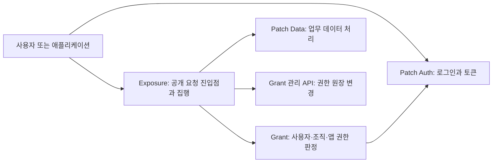

# 테스트 배포 API 안내와 전체 목록 · 2026-10-04

> **2026-10-05 변경 안내:** Grant의 `/api/v1/me/materialize`가 `/api/v1/me/ensure`로 바뀌었고, `/me` 조회는 사용자를 생성하지 않습니다. 아래 목록과 runtime snapshot은 10월 4일 기록입니다. 현재 호출 방법과 배포·기능 점검 결과는 [10월 5일 검증 기록](https://github.com/Conalog/deploy/blob/da4f2f983c6310e23ae6e00b8f94ded63f173ba5/infra/dev/patch/patch-data-grant-exposure-go-v1/verification-2026-10-05-me-ensure.md)을 참고하세요.

이 문서는 테스트 환경에서 어떤 API를 사용할 수 있는지, 각 기능이 왜 필요한지, 어떤 인증과 권한을 준비해야 하는지를 설명합니다. **현재 활성 catalog와 실제 배포 이미지의 계약**을 기준으로 작성했습니다. 로컬 최신 코드나 9월 12일 검증 기록에만 있는 기능은 현재 지원 기능으로 올리지 않습니다. catalog에 등록된 변경 기능은 계약의 존재를 뜻하며, 이번 조사에서 새 데이터를 생성하거나 수정하거나 삭제했다는 뜻은 아닙니다.

전체 메서드·경로·권한 계약은 [TSV 목록](api-inventory.tsv)과 [JSON 목록](api-inventory.json)에 있습니다. 본문은 기능과 사용 이유를 설명하며, 수백 개 경로를 그대로 반복하지 않습니다. 배포 증거는 [런타임 요약](runtime/runtime-summary.md), Grant 요청 형식은 [Grant 상세 가이드](grant-api-guide.md), 업무 데이터와 로그인 요청 형식은 [업무·인증 상세 가이드](business-auth-guide.md)를 함께 참고하세요.

## 먼저 이해하면 좋은 서비스 구조

로그인, 권한 관리, 데이터 처리를 나누는 이유는 각 단계에서 확인해야 하는 사실이 다르기 때문입니다. **인증(authentication)**은 요청자가 누구인지 확인합니다. **인가(authorization)**는 그 사람이 어떤 조직에서 어떤 동작을 어떤 리소스에 수행할 수 있는지 판단합니다. **집행(enforcement)**은 그 판단을 실제 HTTP 요청과 응답에 적용합니다. 로그인에 성공한 사용자라도 다른 조직의 발전소를 읽을 권한까지 자동으로 얻지는 않습니다.



이 그림은 책임의 관계를 설명합니다. 실제 pod·container·Service 연결과 공개 주소 여부는 아래 배포 증거를 따릅니다. 다음 네 가지를 구분하면 API 이름을 이해하기 쉽습니다.

| 구성 요소 | 맡는 일 | 근본적으로 필요한 이유 |
|---|---|---|
| Patch Auth | 로그인, 토큰 갱신, 계정 인증 절차를 처리합니다. | 사용자가 제시한 이름을 그대로 믿지 않고, 인증 서버가 확인한 안정적인 identity를 사용해야 합니다. |
| Grant | 사용자 identity를 내부 사용자와 연결하고 조직, 그룹, 역할, action, resource binding, 앱 동의를 관리합니다. | 로그인 사실과 조직 소속·업무 권한은 다르며, 권한 철회와 조직 간 공유를 일관된 원장에서 판단해야 합니다. |
| Exposure | 활성 catalog의 exact method/path만 받아 Grant 판정과 계약을 적용한 뒤 고정된 upstream으로 전달합니다. | 데이터 서버에 도달하기 전에 허용되지 않은 요청을 차단하고, 목록·관련 데이터·파일에도 같은 권한 경계를 적용해야 합니다. |
| Patch Data | 발전소, 도면, 이슈, 작업 지시, 보고서와 첨부파일 등 업무 자료를 처리합니다. | 업무 자료의 구조와 변경 규칙을 로그인·권한 시스템과 독립적으로 관리해야 합니다. |

권한의 기본 범위는 `provider + resource type + resource id`입니다. 동일한 문자열 ID라도 provider나 resource type이 다르면 같은 권한 대상이 아닙니다. 사용자·조직·provider·application이 활성 상태인지, 사용자가 해당 역할과 리소스 범위를 가지는지, 앱에 필요한 action과 사용자 동의가 있는지를 함께 봅니다. 앱의 action 허용이나 사용자 동의만으로 사용자의 원래 권한을 넘을 수 없습니다.

Patch Data의 `organizations`, `users`, `permissions`, `org_parent_map` 같은 업무 collection 이름은 Grant의 조직 원장이나 권한 원장과 같다는 뜻이 아닙니다. 업무 레코드를 변경하는 작업과 Grant membership·role·binding을 변경하는 작업은 별도 계약입니다. 데이터·인증 분리는 인증 계정에 들어 있는 relation이나 이메일을 권한으로 오인하지 않게 하고, 업무 데이터의 수명과 권한 철회의 수명을 각각 관리하게 합니다.

## 지원 범위와 상태를 읽는 법

- `Exposure-public`은 Exposure가 받아들이는 공개 계약입니다. 여기서 public은 익명 접근을 뜻하지 않으며, catalog의 `accessMode`와 해당 인증 조건을 따라야 합니다. 인터넷에서 연결 가능한지는 ingress 증거와 별개입니다.
- `internal Grant control/admin`은 권한 판정, catalog publication, PEP 관리, bootstrap/import 같은 신뢰된 내부·운영 계약입니다. Exposure 공개 업무 API와 구분합니다.
- `health`는 실행·준비 상태와 운영 지표를 확인하는 계약입니다. 건강 상태가 성공했다고 업무 권한이나 모든 API가 검증된 것은 아닙니다.
- `unsupported/private`는 catalog 밖 경로, 배포 이미지에 없는 로컬 경로, 직접 backend 접근용 경로 등을 구분합니다. 이것은 사용 가능한 API 수에 포함하지 않습니다.

`active-catalog` 상태는 조사 시점의 활성 catalog에서 enabled 계약을 확인했다는 뜻입니다. `image-contract`는 실제 이미지 commit의 route 등록에서 계약을 확인했다는 뜻입니다. 실제 probe 결과는 별도 필드·런타임 증거를 따릅니다. 인증 없는 요청의 거절은 보호 경계 확인이며, 인증·권한을 갖춘 성공 호출이나 변경 성공을 증명하지 않습니다.

최종 인벤토리는 **605개 행**을 문서화합니다. 이는 아래 여러 범위의 합계이며, 모두 현재 사용할 수 있는 공개 API라는 뜻은 아닙니다.

| scope | 문서화 행 수 | 포함 범위와 검증 수준 |
|---|---:|---|
| `Exposure-public` | **438** | data 369개와 management 69개의 현재 활성 계약입니다. |
| `internal Grant control/admin` | **84** | 배포 voter의 non-health 82개와 learner의 catalog·decide 두 개입니다. 같은 기능의 노드별 제공 경계를 별도 행으로 기록합니다. |
| `health` | **10** | Grant voter·learner, 두 Exposure admin listener, 두 native backend의 상태 계약입니다. 읽기 probe에서 모두 200이었습니다. |
| `Patch Auth native` | **70** | [native 인증 route 표](native-auth-routes.tsv)를 상태 그대로 통합했습니다. 아래 검증 구분을 유지하며 Exposure 계약 수에 더하지 않습니다. |
| `unsupported/private` | **3** | 내부 SQL query·execute·read-fence 계약입니다. 일반 업무 공개 API가 아닙니다. |

native 인증 70개 가운데 auth-methods GET 200 한 개, password·OTP 기능 enabled이지만 실제 동작을 실행하지 않은 세 개, OAuth provider 미구성 한 개, 합성 account ID의 GET 404 한 개, **소스의 조건부 설명만 있는 64개**를 구분합니다. 64개를 현재 enabled API로 집계하지 않습니다. viewer·임시 계정, 약관·가입·프로필 변경, 파일·CSAP 추가 경로와 SMTP 전달은 현재 성공 검증이 없으며 source revision도 확정되지 않았습니다.

TSV의 `service`는 논리적 listener·구성 요소 이름이며 Kubernetes Service 이름과 반드시 같지는 않습니다. 연결할 때는 아래 Service 기반 명령을 사용하세요. `capability`와 `action`은 활성 catalog의 실제 ID이고, catalog를 사용하지 않는 native·health·private 경로에는 고정된 catalog ID를 만들어 넣지 않았습니다. 그 행의 `auth`, `status`, `source`와 상세 가이드가 호출 조건을 설명합니다. JSON은 원본 request/query/response·resource 계약, 42개 response resource와 collection 매핑, source version, 검증 한계와 실행 기록도 보존합니다.

## 업무 데이터의 공통 동작과 필요성

collection은 같은 종류의 업무 레코드를 담는 단위입니다. 기본 경로는 `/api/collections/{collection}/records`, 개별 레코드는 그 뒤의 `/{id}`입니다. 여기서 `{collection}`은 자유롭게 바꿀 수 있는 wildcard가 아니라 아래 표의 **실제로 등록된 이름 또는 ID 별칭**을 설명하기 위한 표기입니다. 구체적인 경로는 TSV의 각 행을 따릅니다.

| 동작 | 요청 형태 | 하는 일과 필요한 이유 |
|---|---|---|
| 목록 조회 | `GET .../records` | 여러 레코드를 페이지 단위로 탐색합니다. 사용자가 볼 수 있는 목록 안에서 검색·정렬·페이지 이동을 제공해야 합니다. |
| 단건 조회 | `GET .../records/{id}` | 선택한 레코드의 상세 내용을 확인합니다. 목록의 요약 정보와 구분해서 실제 작업 대상을 확인해야 합니다. |
| 생성 | `POST .../records` | 새 업무 레코드를 만듭니다. 읽기 권한과 새 자료를 등록할 권한은 별도로 제어해야 합니다. |
| 수정 | `PATCH .../records/{id}` | 허용된 레코드를 갱신합니다. 읽기 가능한 모든 사용자가 중요한 업무 정보를 변경해서는 안 됩니다. |
| 삭제 | `DELETE .../records/{id}` | 계약이 허용한 레코드를 삭제합니다. 실제 삭제·비활성화 의미는 backend 계약을 따르며, 수정과 다른 권한으로 제어합니다. |
| 파일 읽기 | `GET /api/files/{collection}/{id}/{filename}` | 허용된 레코드에 붙은 파일을 받습니다. 파일 주소만 알고 있는 사용자가 레코드 권한을 우회하지 못하게 해야 합니다. |
| 파일 확인 | 위 경로의 `HEAD` | 본문을 내려받지 않고 파일 응답 정보를 확인합니다. 화면이나 다운로드 준비에 필요하며 파일 읽기와 같은 보호 경계를 사용합니다. |
| 일괄 요청 | `POST /api/batch` | 여러 하위 작업을 한 요청으로 전달합니다. 왕복 횟수를 줄이되 개별 작업의 허용 계약과 권한을 생략하지 않습니다. 원자성·부분 실패는 상세 가이드와 runtime 계약을 확인하세요. |

목록의 `filter`, `sort`, `page`, `perPage`, `skipTotal`, `expand`는 catalog에서 허용한 경우에만 사용할 수 있습니다. 익숙한 backend query라도 catalog에 없는 parameter는 임의로 전달할 수 없습니다. 목록에는 record scope 조건이 적용되며, 관련 레코드를 펼치는 `expand`도 response authorization 계약을 따릅니다. 필터를 주지 않았다고 전체 데이터를 볼 권한을 얻는 것은 아닙니다. 파일·batch·쓰기에는 각기 다른 request body, content type, 크기 제한과 query 정책이 있으므로 TSV의 capability ID로 JSON의 계약을 찾아보세요.

현재 batch 계약은 최대 20개 하위 작업을 받아들이며, 허용된 C/U/D capability 180개와 별도의 batch 내부 PUT upsert template 60개를 선언합니다. 이 60개는 30개 collection의 이름·ID 별칭이며, 독립된 최상위 HTTP PUT 경로가 아닙니다. JSON의 batch contract에 concrete template, create/update capability와 ID 추출 위치를 모두 보존했습니다. batch 기능을 써도 각 하위 작업의 생성·수정 권한 확인을 생략하지 않습니다.

### 전체 42개 collection의 의미와 경로 매핑

아래 설명은 업무 이름과 가이드에 근거해 각 collection이 필요한 이유를 풀어 쓴 것입니다. 실제 필드와 비즈니스 규칙, 모든 collection의 쓰기 지원 여부를 이름만으로 추정하지 않습니다. `R`은 목록·단건 조회, `C/U/D`는 생성·수정·삭제, `F`는 파일 GET·HEAD입니다. 이름과 ID 별칭은 같은 collection 기능으로 집계합니다.

| collection 이름 | ID 별칭 | 지원 동작 | route 수 | 의미와 필요성 |
|---|---|---|---:|---|
| [`users`](business-auth-guide.md#01-users-업무-사용자-프로필) | `_pb_users_auth_` | R, C/U/D, F | 14 | 업무 사용자 프로필을 조회·관리합니다. 로그인 계정과 동일한 권한 원장으로 해석하지 않습니다. |
| [`plants`](business-auth-guide.md#02-plants-발전소-업무의-기준-객체) | `30hrtar148uy66c` | R, C/U/D | 10 | 발전소를 업무 대상과 권한 범위로 식별합니다. 어느 발전소의 데이터를 처리하는지 명확해야 합니다. |
| [`panelmaps`](business-auth-guide.md#03-panelmaps-발전소-패널-배치-데이터) | `l17r68r7ddzqcij` | R, C/U/D | 10 | 설비·패널 배치를 관리합니다. 현장의 위치와 분석 결과를 연결해야 합니다. |
| [`organizations`](business-auth-guide.md#04-organizations-업무-조직과-계층) | `1l9cjra913llae4` | R, C/U/D, F | 14 | 업무 조직 정보를 관리합니다. Grant의 tenant·membership 변경과는 별도입니다. |
| [`viewers`](business-auth-guide.md#05-viewers-열람자-업무-프로필) | `kovp4j74yv9jr2v` | R, C/U/D | 10 | 열람 대상자의 업무 정보를 관리합니다. 계정 인증 여부와 데이터 열람 권한을 별도로 확인해야 합니다. |
| [`invitations`](business-auth-guide.md#06-invitations-조직발전소-초대-기록) | `lrjsosb8mul77k0` | R, C/U/D | 10 | 업무 초대 정보를 관리합니다. 초대 기록만으로 Grant 소속이나 권한이 자동 부여되지는 않습니다. |
| [`images`](business-auth-guide.md#07-images-재사용-가능한-사진이미지) | `w8l3o9jedinck7g` | R, C/U/D, F | 14 | 업무 이미지를 관리합니다. 이미지 레코드와 첨부파일 접근을 각각 보호해야 합니다. |
| [`dashboard`](business-auth-guide.md#08-dashboard-발전소-대시보드-데이터) | `i95ea9ateuaxwqg` | R, C/U/D | 10 | 업무 화면에서 사용하는 대시보드 정보를 관리합니다. 사용자가 필요한 정보를 모아 볼 수 있어야 합니다. |
| [`comments`](business-auth-guide.md#09-comments-발전소의-일반-의견논의) | `lrsdfyc753nlnz7` | R, C/U/D | 10 | 업무 의견을 관리합니다. 대상 자료에 관한 설명과 협업 내용을 함께 남길 수 있어야 합니다. |
| [`permissions`](business-auth-guide.md#10-permissions-기존-업무-접근-관계) | `pt20y45muocfut5` | R, C/U/D | 10 | 업무 permission 레코드를 관리합니다. 이 collection의 변경을 Grant role·binding 변경과 혼동하지 않습니다. |
| [`groupconditions`](business-auth-guide.md#11-groupconditions-발전소별-조건-묶음) | `1t0dxj7x1r6vvo0` | R, C/U/D | 10 | 업무 그룹 조건을 관리합니다. 조건별 대상 분류를 일관되게 표현해야 합니다. |
| [`passwords`](business-auth-guide.md#12-passwords-조직에-연결된-업무-비밀번호값) | `8ngtkucypa7xlaj` | R, C/U/D | 10 | 업무의 passwords 레코드를 관리합니다. 이름만으로 로그인 비밀번호 저장·변경 API라고 해석하지 않습니다. |
| [`temporary_accounts`](business-auth-guide.md#13-temporary_accounts-한시-업무-참여자의-참조) | `d57i4dxnnp7l8hh` | R, C/U/D | 10 | 임시 계정 관련 업무 정보를 관리합니다. 임시 접근의 업무 기록과 로그인 인증 절차를 구분해야 합니다. |
| [`issue_comments`](business-auth-guide.md#14-issue_comments-이슈에-붙는-현장-논의) | `snv8bayo8ma6hw0` | R, C/U/D | 10 | 이슈에 관한 의견을 관리합니다. 문제 해결 과정에서 소통한 내용을 연결해야 합니다. |
| [`issue_content_logs`](business-auth-guide.md#15-issue_content_logs-이슈-본문-변경-이력) | `misvzvyhp0fe7g4` | R, C/U/D | 10 | 이슈 내용의 변경 기록을 관리합니다. 이전 설명과 변경 이유를 추적할 수 있어야 합니다. |
| [`issue_fields_logs`](business-auth-guide.md#16-issue_fields_logs-이슈-필드-변경-이력) | `v5q8qxup8hbxg21` | R, C/U/D | 10 | 이슈 필드의 변경 기록을 관리합니다. 상태·담당 정보 등의 변경을 추적할 수 있어야 합니다. |
| [`issue_tags`](business-auth-guide.md#17-issue_tags-이슈-분류어) | `i10pcc82twxf6pd` | R, C/U/D | 10 | 이슈 분류 태그를 관리합니다. 비슷한 문제를 찾아 우선순위를 정할 수 있어야 합니다. |
| [`issues`](business-auth-guide.md#18-issues-발전소-문제와-처리-상태) | `hqrb76fyop74r06` | R, C/U/D | 10 | 업무 이슈를 관리합니다. 발견한 문제와 해결 상태를 지속적으로 확인해야 합니다. |
| [`work_orders`](business-auth-guide.md#19-work_orders-여러-이슈를-묶는-작업지시) | `yzruwgkyotkp02h` | R, C/U/D | 10 | 작업 지시를 관리합니다. 해야 할 작업과 처리 대상을 명확히 전달해야 합니다. |
| [`command_history`](business-auth-guide.md#20-command_history-발전소-명령-데이터의-이력) | `ogq6rbg3df1g496` | R, C/U/D | 10 | 명령 실행 관련 업무 이력을 관리합니다. 어떤 작업을 요청했는지 추적해야 합니다. |
| [`issue_schedules`](business-auth-guide.md#21-issue_schedules-이슈에-연결된-일정) | `kyzupz6cwz00swl` | R, C/U/D | 10 | 이슈 처리 일정을 관리합니다. 작업 시점과 후속 조치를 계획해야 합니다. |
| [`reports`](business-auth-guide.md#22-reports-파일로-보관하는-보고서) | `r0thjxht4e4dz2m` | R, C/U/D, F | 14 | 업무 보고서를 관리합니다. 결과를 공유하고 보고서 첨부파일도 같은 접근 경계 안에서 보호해야 합니다. |
| [`files`](business-auth-guide.md#23-files-공통-첨부-파일) | `pbc_3446931122` | R, C/U/D, F | 14 | 업무 파일의 레코드와 첨부 내용을 관리합니다. 파일 목록 조회와 파일 본문 접근을 구분해야 합니다. |
| [`blueprints`](business-auth-guide.md#24-blueprints-날짜를-가진-발전소-설계배치-자료) | `pbc_1114506494` | R, C/U/D | 10 | 도면을 관리합니다. 설비 구조와 현장 작업의 기준 자료가 필요합니다. |
| [`resources`](business-auth-guide.md#25-resources-조직발전소에-연결된-확장-자료) | `pbc_2337082678` | R, C/U/D | 10 | 업무 리소스를 관리합니다. 여러 자료에서 참조하는 대상을 일관되게 식별해야 합니다. |
| [`reports_v2`](business-auth-guide.md#26-reports_v2-구조화된-보고서와-손실-지표) | `pbc_3451676670` | R, C/U/D | 10 | 별도 계약의 보고서 자료를 관리합니다. reports와 필드·규칙이 같다고 추정하지 않습니다. |
| [`org_parent_map`](business-auth-guide.md#27-org_parent_map-조직-조상-관계의-물리화-자료) | `35180llsus0m925` | R, C/U/D | 10 | 업무 조직 상하위 관계를 관리합니다. 이 관계만으로 Grant가 부모 권한을 자식에 전파하지 않습니다. |
| [`plants_viewer`](business-auth-guide.md#28-plants_viewer-열람자용-발전소-투영) | `6260lz1eo0w2vcr` | R | 4 | 발전소 열람용 자료를 읽습니다. 조회 목적에 맞춘 업무 표현이 필요합니다. |
| [`panelmaps_viewer`](business-auth-guide.md#29-panelmaps_viewer-열람자용-패널맵-투영) | `8hamrn2tnq9j6c6` | R | 4 | 패널 배치 열람용 자료를 읽습니다. 원본 변경 없이 배치를 확인해야 합니다. |
| [`temporary_panelmaps`](business-auth-guide.md#30-temporary_panelmaps-한시-화면용-패널맵-투영) | `zkvh97egvg137hs` | R | 4 | 임시 패널 배치 자료를 읽습니다. 임시 업무 상태를 정식 자료와 구분해야 합니다. |
| [`temporary_plants`](business-auth-guide.md#31-temporary_plants-한시-화면용-발전소-투영) | `fiqvrx9bli2qvag` | R | 4 | 임시 발전소 자료를 읽습니다. 임시 업무 대상을 따로 확인해야 합니다. |
| [`temporary_blueprints`](business-auth-guide.md#32-temporary_blueprints-한시-화면용-설계-자료-상세) | `pbc_405412299` | R | 4 | 임시 도면 자료를 읽습니다. 작업 중인 기준 자료를 정식 도면과 구분해야 합니다. |
| [`blueprints_viewer`](business-auth-guide.md#33-blueprints_viewer-열람자용-설계-자료-상세) | `pbc_1337089469` | R | 4 | 도면 열람용 자료를 읽습니다. 조회 목적에 맞는 표현을 제공해야 합니다. |
| [`latest_loss_reports`](business-auth-guide.md#34-latest_loss_reports-발전소별-최신-비보관-보고서) | `pbc_1915755548` | R | 4 | 최근 손실 보고 자료를 읽습니다. 최신 손실 상태를 확인할 수 있어야 합니다. |
| [`reports_v2_list`](business-auth-guide.md#35-reports_v2_list-본문을-뺀-비보관-보고서-목록) | `pbc_2089487142` | R | 4 | 보고서 목록용 자료를 읽습니다. 상세 보고서를 모두 읽기 전에 탐색할 수 있어야 합니다. |
| [`blueprints_list`](business-auth-guide.md#36-blueprints_list-본문을-뺀-설계-자료-목록) | `pbc_1185224127` | R | 4 | 도면 목록용 자료를 읽습니다. 필요한 도면을 먼저 찾을 수 있어야 합니다. |
| [`rsd_command_tasks`](business-auth-guide.md#37-rsd_command_tasks-rsd-명령-작업-상태) | `pbc_4011293327` | R | 4 | RSD 명령 작업 자료를 읽습니다. 작업 조회 계약이 명령 실행 권한까지 뜻하지는 않습니다. |
| [`agreement_documents`](business-auth-guide.md#38-agreement_documents-버전이-있는-약관-문서) | `pbc_165310787` | R, C/U/D | 10 | 업무 계약 문서를 관리합니다. Grant agreement와 별도로 실제 문서 내용을 보관해야 합니다. |
| [`anomaly_occurrences`](business-auth-guide.md#39-anomaly_occurrences-이상-발생과-해소의-단위-기록) | `anomalyoccur001` | R, C/U/D | 10 | 이상 발생 정보를 관리합니다. 발견한 이상과 처리 대상을 추적해야 합니다. |
| [`blueprints_viewer_list`](business-auth-guide.md#40-blueprints_viewer_list-열람자용-설계-자료의-가벼운-목록) | `pbc_1337089470` | R | 4 | 열람용 도면 목록을 읽습니다. 상세 내용을 열기 전에 접근 가능한 자료를 찾을 수 있어야 합니다. |
| [`temporary_blueprints_list`](business-auth-guide.md#41-temporary_blueprints_list-한시-화면용-설계-자료-목록) | `pbc_405412300` | R | 4 | 임시 도면 목록을 읽습니다. 작업 중인 임시 자료를 탐색할 수 있어야 합니다. |
| [`anomaly_occurrence_checkpoints`](business-auth-guide.md#42-anomaly_occurrence_checkpoints-이상-처리의-진행-위치) | `projcheckpoint1` | R, C/U/D | 10 | 이상 발생 처리의 체크포인트를 관리합니다. 처리 진행 상태와 후속 확인 지점을 기록해야 합니다. |

## Grant에서 관리하는 기능과 필요한 이유

Grant 관리 API는 권한이 형성되는 과정을 다룹니다. 상세 payload와 모든 경로는 [Grant 가이드](grant-api-guide.md)와 TSV에 있지만, 다음 표만으로도 각 기능의 용도를 구분할 수 있습니다.

활성 관리 69개의 compact 집계는 identity 2, 조직·owner·상태 8, 앱 10, consent·grant 5, 그룹 9, membership 3, agreement 5, 역할 8, binding 3, provider·action 조회 2, 플랫폼 운영 관리 11, catalog 관리 3입니다. 플랫폼 운영 관리 11개와 catalog 관리 세 개를 합친 14개는 아래의 **P 인증 경로**이며 master 전용 경로가 아닙니다.

| 기능군 | 주요 동작 | 필요한 이유 |
|---|---|---|
| 내 정보·identity materialize | `/me` 조회, `/me/materialize` | 외부 로그인 주체와 Grant 내부 사용자를 연결해 요청자의 권한을 확인합니다. materialize만으로 조직 가입이나 권한이 생기지는 않습니다. |
| provider·action 목록 | provider 조회, action 조회 | 어떤 서비스와 동작에 권한을 부여할 수 있는지 확인합니다. 인증 공급자와 권한 대상 provider를 구분해야 합니다. |
| 조직·owner | 조직 목록·상세·생성·수정, owner 조회·이전, 조직 비활성화·재활성화 | 조직을 권한 평가 단위로 유지하고 최종 관리 책임자를 명확히 합니다. 비활성화로 해당 조직의 접근을 중단할 수 있습니다. |
| membership | 사용자 등록·목록·제거 | 인증된 사용자 중 누가 조직에 속하는지 결정합니다. 로그인 성공을 조직 가입으로 해석하지 않습니다. |
| 그룹·그룹 회원 | 그룹 생성·조회·수정·삭제, 회원 추가·제거 | 같은 업무를 수행하는 사람들을 묶어 권한 관리를 반복하지 않게 합니다. 같은 조직의 active membership 경계를 유지해야 합니다. |
| 역할·role action | 역할 생성·조회·수정·삭제, action 전체 교체·추가·제거 | 직무에 필요한 동작들을 재사용 가능한 묶음으로 관리합니다. 역할 이름만으로 권한이 생기지 않고 action과 binding이 필요합니다. |
| resource binding | binding 목록·생성·삭제 | 누가 어떤 역할을 어느 provider/resource에 사용할지 지정합니다. 읽기 역할이 있다고 모든 발전소를 볼 수 있는 것은 아닙니다. |
| 조직 간 agreement | 목록·상세·생성·PUT/PATCH 갱신 | 다른 조직의 리소스를 공유하는 명시적 근거와 기간·상태를 관리합니다. 계약과 실제 binding을 함께 확인해야 합니다. |
| application | 앱 목록·상세·생성·수정·활성 변경·삭제, action 조회·교체·추가·제거 | 애플리케이션별로 사용할 기능을 제한하고 철회합니다. 앱을 등록하는 것과 사용자가 앱에 동의하는 것은 별개입니다. |
| consent·app grant | 본인의 consent 조회·전체 교체·회수, 조직 grant 목록·회수 | 앱이 사용자 대신 수행할 동작의 범위를 정합니다. 조직 관리자 권한과 사용자의 동의 권한을 혼동하지 않습니다. |
| provider·action 운영 관리 | provider 생성·수정, action 생성·갱신·삭제·전체 교체 | 권한 엔진이 알 수 있는 서비스와 동작을 운영자가 정의합니다. 무등록 동작을 허용하지 않기 위해 필요합니다. |
| HTTP catalog | active 조회, generation stage, active 전환 | HTTP 메서드·경로를 action/resource로 정확히 연결합니다. stage와 공개 activation을 나누어 미완성 계약이 바로 적용되지 않게 합니다. |
| 앱 trust·identity binding, 사용자 active | 플랫폼 관리(P)로 신뢰 설정·identity 연결·사용자 활성 변경. **identity binding은 현재 PocketBase 모드에서 사용 불가(409)** | 보안 경계에 영향을 주는 설정을 제한된 관리 계약으로만 변경합니다. 사용자가 스스로 trusted 상태나 다른 identity를 선택하지 못하게 합니다. |
| 내부 check·batch-check·filter | 단건·다건 판정, 제시한 후보 ID 중 허용 목록 반환 | 데이터 서버가 권한을 추측하지 않고 일관된 판정을 받게 합니다. Grant는 외부 provider의 모든 리소스를 열거하지 않습니다. |
| 내부 PEP·catalog·bootstrap·import | PEP 등록과 lifecycle, 권한 초기 연결, authority import | 신뢰된 요청 집행자와 권한 원장의 출처를 명확히 합니다. 일반 최종 사용자에게 배포 키를 전달하는 기능이 아닙니다. |

`PUT`의 전체 교체와 항목별 추가는 결과가 다릅니다. action 목록을 통째로 바꾸면 기존 항목이 빠질 수 있고, 항목별 추가·제거는 지정한 항목을 다룹니다. 일부 PUT/PATCH 쌍은 같은 관리 기능을 서로 다른 요청 계약으로 제공하며 별도 사업 기능으로 중복 집계하지 않습니다. ETag와 `If-Match`, generation의 CAS 전제가 요구되는 경로에서는 현재 버전을 먼저 읽어 다른 관리자의 변경을 덮어쓰지 않도록 합니다. `consistency` query도 등록된 조회 경로에서만 쓸 수 있습니다.

### 내부 Grant와 공개 관리 Exposure의 차이

실제 Grant 이미지 commit의 voter fixture는 **84개 메서드·경로**이며, 그중 health 두 개를 제외한 82개가 내부 제어·관리 계약입니다. [배포 route 표](grant-deployed-routes.tsv)를 기준으로 인벤토리에 기록했습니다. 별도 learner에서는 `/healthz`, `/readyz`, `GET /api/v2/http-capabilities/catalog/{providerId}`, `POST /api/v2/http-capabilities/decide`만 처리합니다. 일반 조직 조회 GET까지 learner가 제공한다고 생각하면 안 됩니다. 등록되어 있는 다른 경로는 learner 경계에서 503으로 막힙니다.

| 내부 운영 기능 | 이번 배포의 정확한 경로 | 필요한 이유 |
|---|---|---|
| 최초 owner 연결 | `POST /api/v1/admin/bootstrap/owner` | 검증된 로그인 identity와 명시한 조직에 초기 관리 책임자를 연결합니다. master와 bearer, 조직 문맥이 필요하며 일반 가입과 구분합니다. |
| 백업 생성·목록 | `POST`·`GET /ops/backups` | 권한 원장을 복구할 자료를 만들고 보관 상태를 확인합니다. 생성 요청이 접수되는 것과 백업 완료는 다른 상태입니다. |
| authority snapshot import | `POST /ops/migrations/patch-data-authority` | 검증된 원본 권한 자료를 generation·digest·provenance와 함께 명시적으로 적용합니다. 업무 collection CRUD와 다릅니다. |
| PEP 등록·lifecycle | `PUT /ops/providers/{providerId}/enforcers/{pepClientId}` | 어떤 집행자가 어떤 provider의 계약을 가져와 사용할 수 있는지 연결합니다. 일반 사용자 토큰과 서비스 자격을 분리하기 위해 필요합니다. |
| HTTP 계약 조회·판정 | `GET /api/v2/http-capabilities/catalog/{providerId}`, `POST /api/v2/http-capabilities/decide` | exact HTTP 요청을 현재 활성 계약과 권한에 결합합니다. 요청의 action·resource·digest·유효기간을 임의로 바꾸지 못하게 합니다. |

이 운영 경로를 최신 로컬 문서의 `/api/v1/admin/backups`, `/api/v1/admin/imports/...`, `/api/v1/admin/providers/.../pep-clients/...`로 바꾸어 호출하면 현재 배포 계약과 맞지 않습니다. 내부 voter는 pod 안의 loopback 8080이고 `grant-management` Service는 Exposure 8084입니다. 둘은 인증 경계도 다릅니다.

management catalog의 69개는 모두 `authorized`·`forward-user`이며, 공개 관리 요청은 사용자 Bearer와 `X-Organization-ID`를 전달합니다. 이 중 플랫폼 관리 **P 경로 14개**는 직접 voter에 master key를 보내는 방법과, master header 없이 서버에 설정된 management 조직의 Bearer·조직 문맥을 사용하는 방법을 지원합니다. 사용자 경로에서는 해당 `grant-management.*` action에 대해 `(grant-management, platform, grant)` 범위의 앱 허용·RBAC·동의를 검사합니다. Exposure가 master key를 전달하지 않아도 이 사용자 인증 경로로 호출할 수 있습니다. 로그인이나 임의 조직의 관리자 역할만으로 플랫폼 권한을 얻는 것은 아닙니다.

배포 handler의 `AuthorizePlatformManagement`는 관리 조직 설정이 없으면 503, 다른 조직을 선택하면 403을 반환합니다. 실제 사용자에게 필요한 action·binding·앱·동의가 있어야 하며, 이번 조사에서 공개 Bearer 경로의 전체 성공을 실행한 것은 아닙니다. 반면 **M 경로**인 내부 `/ops/*`, owner bootstrap, v1 `/api/v1/authz/*`는 master 전용입니다. application-authz는 별도의 앱 서비스 키·사용자 Bearer·조직 문맥을 사용하는 판정 계약입니다. 인벤토리는 P/M과 이러한 서비스 인증을 경로별로 구분합니다.

등록된 계약과 현재 설정에서 실행 가능한 workflow도 구분해야 합니다. `PUT /api/v1/admin/orgs/{organizationId}/apps/{applicationId}/identity-binding`은 활성 catalog와 배포 route에 있지만 Rauthy client를 대조하는 전용 hook입니다. **현재 PocketBase 모드에서는 해당 provider 검증 단계가 409로 거부되므로 이 identity-binding workflow를 사용할 수 없습니다.** P 인증이나 직접 master 인증을 통과해도 인증 공급자 전제가 바뀌지는 않습니다. 이는 배포 소스와 현재 설정을 대조한 제한이며, 이번 조사에서 새 변경 요청으로 409를 실측한 것은 아닙니다. [Grant 가이드 4.13](grant-api-guide.md#413-trustidp-identity-연결사용자-정지-6769)에 자세한 전제와 다른 오류 조건이 있습니다. 따라서 활성 관리 계약 69개·전체 Exposure 계약 438개를 모두 현재 실행 가능한 workflow나 성공 검증 수로 해석하지 않습니다.

private runtime의 `POST /sql/query`, `POST /sql/execute`, `POST /read-fence`는 복제·DB 실행·읽기 fence를 위한 운영 계약입니다. 각각 쿼리, transaction 실행, 최신 판정 자료의 확인을 지원하기 때문에 필요하지만 일반 사용자용 업무 API가 아니며 `unsupported/private` scope로 따로 기록합니다. private 자격을 업무 사용자에게 제공하는 사용법은 이 안내의 범위가 아닙니다.

health는 프로세스의 생존을, readiness는 읽기·쓰기 요청을 받을 준비를 확인합니다. 두 검사를 나누어야 살아 있는 프로세스를 의존성 문제 때문에 반복 재시작하거나 준비되지 않은 replica로 요청을 보내는 일을 줄일 수 있습니다. Exposure health/readiness는 admin listener의 8083·8085에 있으며, 업무 listener에 같은 경로가 공개된 것으로 해석하지 않습니다.

## 로그인과 계정 기능을 읽는 법

Patch Auth는 이 환경에서 native API로 직접 호출합니다. 20:44:38 KST에 `GET /api/collections/users/auth-methods`가 200을 반환했고 password, OTP, MFA가 enabled로 나타났습니다. password identity field는 `email`, `username`입니다. OAuth2 flag는 true이지만 `providerIds=[]`이므로, 구성된 외부 OAuth 로그인 provider가 있다고 안내하지 않습니다. MFA enabled도 독립된 MFA route가 있다는 뜻은 아닙니다. [현재 auth-methods snapshot](runtime/patch-auth-auth-methods.json)을 기준으로 읽어 주세요.

| 인증·계정 기능 | 기능의 의미와 필요한 이유 | 현재 근거 수준 |
|---|---|---|
| 인증 방식 조회 | 앱이 실제 사용할 로그인 방식을 확인합니다. 설정되지 않은 방식을 화면에 제공하지 않기 위해 필요합니다. | `users/auth-methods` 읽기 성공 |
| 비밀번호 로그인 | email 또는 username과 비밀번호로 계정 소유를 확인합니다. 업무 데이터의 사용자 프로필 조회와 다른 기능입니다. | password enabled 확인; 새 로그인은 실행하지 않음 |
| OTP 요청·인증 | 일회용 코드로 계정 소유를 확인합니다. 비밀번호와 별개의 인증 절차를 제공하기 위해 필요합니다. | OTP enabled 확인; 코드 발송·인증은 실행하지 않음 |
| MFA | 추가 인증 단계를 요구합니다. 첫 번째 인증 수단만으로 로그인하지 않도록 구성할 수 있습니다. | enabled 확인; 전체 MFA 성공 흐름 미검증 |
| 토큰 갱신·검증 | 기존 인증 토큰을 인증 서버에서 다시 확인합니다. 만료·철회 상태를 무시하지 않기 위해 필요합니다. | Grant PocketBase 모드의 연동 계약; 이번에 refresh는 실행하지 않음 |
| 비밀번호 재설정 요청·확정 | 계정 소유 확인 뒤 로그인 수단을 복구합니다. 업무 레코드 `passwords`를 수정하는 것과 구분해야 합니다. | native 계약과 상세 가이드의 검증 한계를 따름 |
| 이메일 검증 요청·확정 | 계정의 이메일 소유를 확인합니다. 요청자가 입력한 이메일을 검증된 identity로 바로 믿지 않기 위해 필요합니다. | native 계약과 상세 가이드의 검증 한계를 따름 |
| 이메일 변경 요청·확정 | 새 연락·인증 주소의 소유를 확인하면서 변경합니다. 단순 업무 프로필 수정과 다른 보안 절차입니다. | native 계약과 상세 가이드의 검증 한계를 따름 |
| OAuth2 로그인 | 외부 인증 provider로 계정 소유를 확인하는 방식입니다. | flag만 enabled; provider 미구성으로 현재 구성된 기능에 포함하지 않음 |

native 인증 경로의 정확한 template와 요청 조건은 [업무·인증 가이드](business-auth-guide.md)를 따릅니다. 일반적인 PocketBase 기능 전부가 이 이미지·설정에서 동작한다고 추정하지 않습니다. 특히 native 기능의 설정 확인, route 계약 확인, 실제 성공 호출을 구분합니다.

Grant는 authentication에 성공한 identity를 조직·application 문맥과 연결해 authorization을 판단하고, Exposure는 그 결과를 HTTP 요청에 집행합니다. 이번 배포는 `GRANT_AUTH_PROVIDER=pocketbase`, 인증 collection은 Patch Auth의 `users`입니다. 인증용 Exposure와 활성 account catalog는 확인되지 않았으므로 native Patch Auth 기능을 아래 438개 Exposure 계약과 합치지 않습니다.

## 배포 근거·집계·검증 한계

catalog는 **2026-10-04 20:37:03 KST**에 조회했고, 전체 런타임 관측 범위는 **20:37:03~20:46:34 KST**입니다. health·denial probe는 **20:43:50~20:46:10 KST**에 수집했습니다. catalog fetch의 `issuedAt`·`expiresAt`은 응답 envelope의 유효기간이고 서비스가 배포된 시각은 아닙니다.

| 활성 계약 | generation | 메서드·경로 수 | 기능 기준으로 읽는 법 |
|---|---:|---:|---|
| `patch-data` | 1 | 369 | 42개 collection 조회 168개, 30개 collection의 C/U/D 180개, 5개 collection의 파일 GET/HEAD 20개, batch 1개입니다. 이름·ID 별칭을 포함합니다. |
| `grant-management` | 5 | 69 | 현재 관리 계약 전체입니다. 과거의 3개 경로 목록으로 대체하지 않습니다. |
| Exposure 합계 | — | **438** | 고유한 `service/provider/method/path` 조합 수이며, 사업 기능 438개나 성공 검증 438회를 뜻하지 않습니다. |
| 인증 account catalog | — | 미확인 | 인증용 Exposure가 없으며, 두 provider 이름 조회의 404만으로 모든 provider가 없다고 단정하지 않습니다. native Patch Auth는 별도입니다. |

data catalog digest는 `sha256:c731b83d70142bed04cc68e829cedc08acaa357645feb295097e25de371a99b4`, management digest는 `sha256:41a7d3ac23e7c3a4f820b553077cb9e01bd0eb38e9105b33196b7af8a1d66a2e`입니다. 각각 [data snapshot](runtime/catalog-data.json), [management snapshot](runtime/catalog-management.json)으로 추적할 수 있습니다.

| 배포 | desired / ready / available | 현재 Running pod의 일반 container | 관측한 pod 생성 시각(UTC) |
|---|---|---|---|
| `data-stack` | 1 / 1 / 1 | patch-data, grant-learner, exposure-data 모두 Ready, 재시작 0회 | 2026-10-04 07:14:43 |
| `grant-voter` | 1 / 1 / 1 | grant-voter, exposure-management 모두 Ready, 재시작 0회 | 2026-09-22 12:40:29 |
| `patch-auth` | 1 / 1 / 1 | patch-auth Ready, 재시작 0회 | 2026-10-04 10:37:55 |

현재 Running pod는 3개이고 일반 container는 6개입니다. 전체 pod 목록에는 과거 Evicted/Succeeded 상태의 5개 pod도 남아 있으므로, 전체 8개 중 일부가 Ready가 아니라는 사실을 현재 서비스 장애로 해석하지 않습니다. [workload snapshot](runtime/cluster-workloads.json)과 [ready endpoint snapshot](runtime/network-access.json)이 이 구분의 근거입니다. pod 생성 시각은 이미지 빌드 시각이나 모든 기능의 최종 배포 시각과 같지 않습니다.

| 구성 요소 | 실행 이미지 digest | 확인된 버전·commit |
|---|---|---|
| Grant voter·learner | `sha256:2d5f035e4feab74cbfd662f68f799bea595852881df207fec64148851d459296` | `20260922-16020fe`, commit `16020fe78bc4a1908f8cc105f0a0c728f5bbce4e`; 이미지 생성 2026-09-22T12:30:59.239Z |
| Exposure data·management | `sha256:6af2e07288a8977ac707aff7ee4a5a9336ffabc9f5931140b952298e9703af1c` | OCI version/revision label이 없어 commit을 확정하지 않습니다. |
| Patch Data | `sha256:e0a3c463ab15b93297b6e3045d3fba3842bb5b8201cf4c0a6d0d10f2eb17113b` | `20260909-b725857`, commit `b7258579b92808b2f1c56795034214946224a602`; 이미지 생성 2026-09-08T17:52:06.231Z |
| Patch Auth | `sha256:89adab664fa7f7be9457d8a5d1b1e31ca890e618b84cbcced60ed89975dfb335` | OCI version/revision label이 없어 commit을 확정하지 않습니다. |

이미지 출처와 label은 [Grant](runtime/image-grant.json), [Exposure](runtime/image-exposure.json), [Patch Data](runtime/image-patch-data.json), [Patch Auth](runtime/image-patch-auth.json) snapshot에 있습니다. Exposure에는 registry의 `sha-d7807e6395513702ea958eaad35dfa5238f17136` 태그가 연결되어 있고, Patch Auth에는 서로 다른 SHA 태그 두 개가 같은 digest에 연결되어 있습니다. 태그는 변경 가능하며 OCI revision label과 같은 확정 근거로 취급하지 않습니다. 자세한 후보는 [런타임 요약](runtime/runtime-summary.md)에 있습니다.

로컬 Grant HEAD는 `3d9d4018bfc044421caffba4001901052c1569a3`으로 배포 commit과 다릅니다. provider/action/active catalog 관련 GET 세 개는 과거 문서에 미배포로 쓰여 있지만, 현재 management catalog와 배포 fixture에 등록되어 있고 voter의 action·active catalog 조회가 실제 읽기 probe에서 성공했습니다. 조직별 provider action GET은 조직 헤더가 없는 최초 요청에서 400, 합성 조직 ID·헤더를 사용한 후속 무인증 요청에서 401을 반환했습니다. 정상 사용자 권한을 갖춘 성공 조회라고 쓰지 않습니다. 현재 증거가 과거 문구보다 우선하되, 각 probe의 범위는 유지합니다.

최종 [probe snapshot](runtime/health-denial-probes.json)에는 GET 19개가 있습니다. health 6개와 readiness 4개는 모두 200이고, 무인증 경계 검사 7개는 모두 401입니다. 처음 사용한 잘못된 data ID의 422와 조직 헤더가 없는 요청의 400도 별도로 남았습니다. 유효한 형식의 합성 ID `inventory000001`로 data 단건을 다시 조회하여 401을 확인했으므로 입력 형식 검사와 인증 경계 검사를 구분할 수 있습니다. 별도 native auth-methods GET은 200, 존재하지 않는 합성 account 단건 GET은 404였으며, 이 두 개는 19개에 포함하지 않습니다.

learner readiness는 `readReady=true`, `writeReady=false`, voter는 둘 다 true였습니다. Exposure의 admin listener에서 health/readiness는 성공했지만 이는 공개 업무 경로가 아닙니다. 이번 조사 결과는 health/readiness, 활성 catalog·일부 관리 metadata의 읽기와 무인증 거절 검증입니다. 438개 전체를 정상 사용자 권한·업무 입력으로 호출하지 않았습니다. 9월 12일의 변경 성공 기록을 이번 조사에서 새로 성공한 것처럼 인용하지 않습니다. 새 로그인·토큰 갱신·쓰기·삭제·배포·스키마 변경은 수행하지 않았습니다. [account 범위 확인](runtime/catalog-account-status.json)도 현재 검증 범위를 보여 줍니다.

### 테스트 환경에 연결하기

현재 관측한 context는 `gke_patch2-the-new-era_asia-northeast3_ied-cluster`, namespace는 `patch-data-grant-exposure-go-v1`입니다. `exposure` Service는 업무 Exposure, `grant-management` Service는 관리 Exposure, `grant` Service는 내부 Grant learner를 가리킵니다. `grant-management`라는 Service 이름을 Grant voter의 직접 API 주소로 해석하지 마세요. Patch Auth는 `patch-auth` Service로 직접 제공되며, 이 namespace에는 인증용 Exposure가 배포되지 않았습니다.

아래 명령은 각각 별도 터미널에서 실행합니다. Service port와 실제 container port가 다른 경우에는 Service port를 사용합니다.

```sh
kubectl --context gke_patch2-the-new-era_asia-northeast3_ied-cluster \
  -n patch-data-grant-exposure-go-v1 port-forward svc/exposure 18082:8082

kubectl --context gke_patch2-the-new-era_asia-northeast3_ied-cluster \
  -n patch-data-grant-exposure-go-v1 port-forward svc/grant-management 18084:8084

kubectl --context gke_patch2-the-new-era_asia-northeast3_ied-cluster \
  -n patch-data-grant-exposure-go-v1 port-forward svc/patch-auth 18091:8091

kubectl --context gke_patch2-the-new-era_asia-northeast3_ied-cluster \
  -n patch-data-grant-exposure-go-v1 port-forward svc/grant 18086:8080
```

앞의 세 주소는 각각 `http://127.0.0.1:18082`, `http://127.0.0.1:18084`, `http://127.0.0.1:18091`입니다. 마지막 주소는 내부 Grant learner 점검용이며 일반 업무 호출 주소가 아닙니다. 이 명령은 API에 필요한 인증·권한을 만들어 주지 않습니다. 클러스터 metadata에는 해당 Service가 ClusterIP로 나타나며, 관측 범위에서 외부 ingress/gateway 경로는 확인되지 않았습니다. 따라서 인터넷 공개 URL이 있다고 주장하지 않습니다.

### 응답을 판단할 때 자주 헷갈리는 점

- 로그인에 성공해도 Grant membership, resource binding과 앱 문맥이 맞지 않으면 업무 접근은 허용되지 않습니다. Patch Data `users` 레코드는 업무 프로필이고, 이번 Grant 인증은 Patch Auth `users` collection을 사용합니다.
- 목록 조회는 허용된 행만 반환할 수 있습니다. 볼 수 있는 행이 없으면 `200`과 빈 목록이 나올 수 있으므로, `200`만 보고 모든 데이터에 접근 가능하다고 해석하지 않습니다. 인증 실패·catalog 계약 실패와는 별도로 구분합니다.
- 상위 조직·발전소·부모 레코드의 권한은 펼친 하위 레코드나 첨부파일의 권한까지 자동으로 뜻하지 않습니다. `expand` 결과는 관련 리소스의 response authorization 계약을 따라야 하고, 파일은 별도 file-read action을 확인합니다. 민감한 첨부파일이 부모 레코드 조회를 통해 노출되지 않게 하기 위해 필요합니다.
- 이름 경로와 collection ID 별칭 경로는 같은 canonical collection의 action/resource 권한에 연결됩니다. 별칭을 써서 다른 권한을 얻는 것이 아니며, 경로 수와 업무 기능 수를 구분해야 합니다.
- 인증 공급자로 PocketBase를 사용한다는 사실은 Rauthy 전용 프록시나 provisioning 기능까지 사용할 수 있다는 뜻이 아닙니다. local 코드에 존재하는 조건부 route도 이 배포 모드에서 실행 가능한지 따로 확인합니다.
- `404`, `401`, `403`, `422`, `503`은 각각 경로·대상 부재, 인증 실패, 권한 거절, 계약 문제, 의존성·준비 상태 문제와 관련될 수 있습니다. 정확한 의미는 해당 route와 상세 가이드의 응답 계약을 따르며, 한 status만으로 성공 범위나 실패 원인을 확정하지 않습니다.

collection 정의 조회 snapshot은 현재 `401`로 실패하여 `collections: []`를 기록했습니다. 따라서 이 문서는 42개 collection의 **활성 경로와 alias 계약**을 확인한 것이며, 현재 field/type/relation 정의를 다운로드하여 검증한 것은 아닙니다. 업무 이름에 관한 설명은 용도를 이해하기 위한 설명이고, 실제 필드와 relation을 보증하지 않습니다. catalog에 포함된 recordScope·responseAuthorization 계약은 JSON 목록에서 확인할 수 있습니다.

반면 활성 data catalog의 `responseResources`에는 42개 canonical resource와 74개 relation 선언이 있습니다. 이것은 현재 Exposure가 응답 권한을 적용할 때 쓰는 계약이며, backend collection의 실제 field/type/relation 전체를 검증한 schema dump는 아닙니다. JSON 목록은 각 collection에 해당 response resource를 연결하고 전체 선언도 보존합니다. [Grant 권한 모델](../../authorization-model.md), [HTTP capability 계약](../../http-capabilities.md), [DB 구조와 책임](../../database-schema.md)은 개념을 더 설명하지만, 최신 로컬 문서에 있는 경로를 현재 배포 지원 목록에 추가하는 근거로 사용하지 않습니다.
